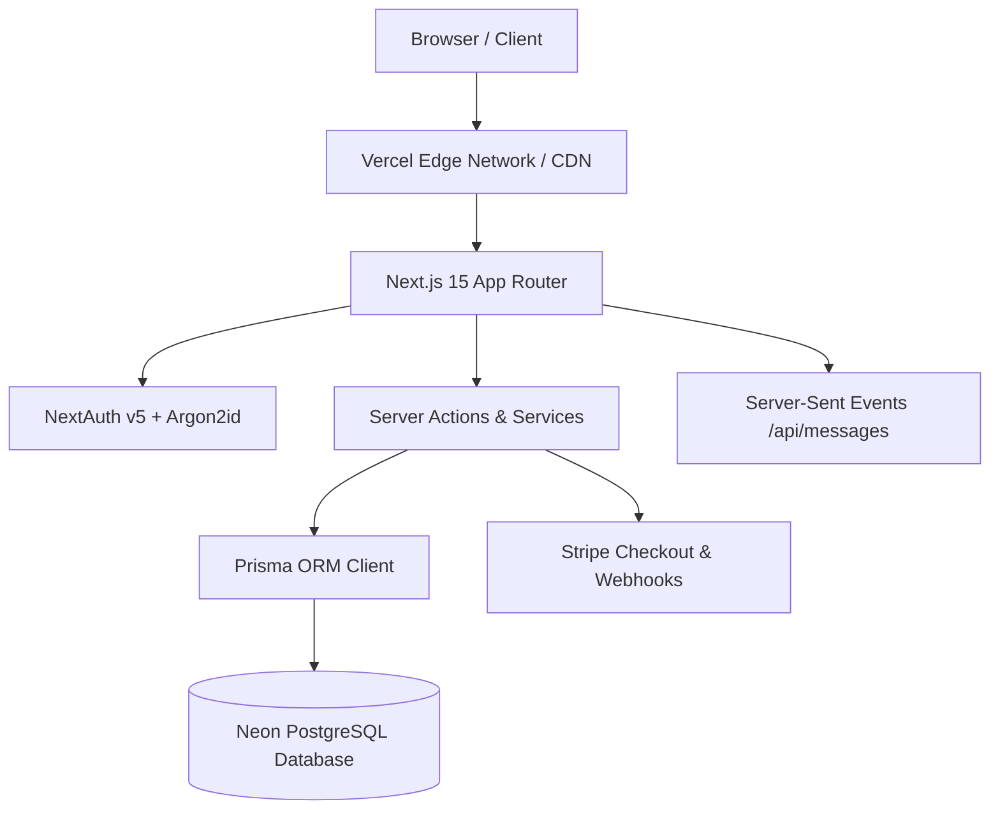

# 01. Platform Architecture & Tech Stack

## Overview
WorkNest is built as an enterprise-grade freelance marketplace designed for high financial trust, cryptographic auditability, and sub-second user experience. The application runs entirely on Next.js 15 App Router with full React Server Component (RSC) streaming, server actions for transactional mutability, and a unified PostgreSQL database with Prisma ORM.

---

## Architectural Principles

1. **Server-First by Default**: Pages and read operations leverage React Server Components directly querying the database, eliminating client-side fetch waterfalls and unnecessary API serialization overhead.
2. **Integer Minor-Unit Financials**: All currency values are strictly stored and computed as integer cents (`BigInt` / minor units) to guarantee that zero rounding drift occurs across payments, fees, or escrow splits.
3. **Double-Entry Financial Ledger**: Every financial event (escrow funding, milestone release, client refund, dispute settlement) generates balanced credit and debit ledger entries to ensure that funds are cryptographically accounted for.
4. **Isolated Operational Shells**: The platform isolates the public marketplace and client/freelancer dashboards (`/(dashboard)`) from the administrative command center (`/admin`), providing a tailored desktop sidebar console for governance.

---

## Technology Stack



- **Framework**: Next.js 15.5.28 (App Router, Turbopack, Standalone/Vercel serverless runtime)
- **Language**: TypeScript 5.8+ (Strict typechecking, `noEmit`, strict null checks)
- **Styling**: Tailwind CSS v4 (Custom shimmer animations, dynamic theme colors, responsive grid)
- **Database & ORM**: PostgreSQL via Neon Serverless + Prisma ORM 6.6
- **Authentication**: NextAuth.js v5 beta + Argon2id password hashing + JWT sessions
- **Payment Processing**: Stripe Checkout & Webhooks (Escrow intent architecture)
- **UI & Interaction**: Lucide React, Sonner rich toast notifications, Custom SVG Sparklines
- **Testing**: Vitest 3.2+ with 56 unit tests across services, crypto, money math, and state machines

---

## Key Directory Structure

```
xcs-job-portal/
├── docs/                     # Modular architectural documentation
├── prisma/
│   ├── schema.prisma         # Unified database models & relations
│   └── seed.ts               # Production-grade idempotent data seeder
├── src/
│   ├── app/                  # Next.js App Router
│   │   ├── (auth)/           # Login, Register, Password Recovery
│   │   ├── (dashboard)/      # Client & Freelancer workspaces
│   │   ├── (marketing)/      # Landing page & public discovery
│   │   ├── admin/            # High-governance Admin Sidebar Console
│   │   └── api/              # Cron jobs, webhooks, health endpoints
│   ├── components/           # Reusable UI components & layouts
│   │   ├── admin/            # Admin console components (Sidebar, Topbar, Modals)
│   │   ├── chat/             # Real-time messaging UI
│   │   ├── forms/            # Client forms with validation
│   │   └── ui/               # Design system primitives & Skeletons
│   └── server/               # Core backend domain logic
│       ├── actions/          # Next.js Server Actions
│       ├── db/               # Prisma singleton client
│       ├── lib/              # Auth, Stripe, Encryption, Rate Limiting
│       ├── policies/         # RBAC Authorization policies
│       └── services/         # Domain business logic & ledger orchestration
└── tests/                    # Vitest unit test suites
```

---

## System Health & Telemetry

- **Health Endpoint**: `/api/health` returns JSON uptime, database ping latency, and environment status.
- **Auto-Healing Database Seeder**: If the database is freshly initialized or tables are empty upon login, `AuthService.verifyCredentials` automatically invokes the seeder on-the-fly to guarantee test credentials work seamlessly.

