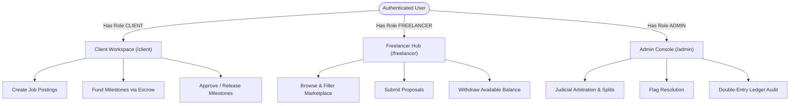

# 02. Authentication & Multi-Role RBAC

## Overview
WorkNest implements a robust, multi-role authentication and authorization architecture using **NextAuth.js v5 (Auth.js)**, **Argon2id** password hashing, and role-based access control (RBAC). A single user account can hold multiple roles (e.g., both `CLIENT` and `FREELANCER`, or `ADMIN`), allowing seamless workspace switching without requiring multiple sign-in accounts.

---

## Key Files & Modules
- `src/server/lib/auth.ts`: Auth.js configuration, credentials provider, JWT & session callbacks.
- `src/server/services/auth.service.ts`: User registration, Argon2id password verification, email token creation, password reset workflows, and auto-seed self-healing trigger.
- `src/server/policies/`: Fine-grained permission rules for contracts, proposals, and governance actions.
- `src/app/(auth)/`: Authentication views (`/login`, `/register`, `/forgot-password`, `/reset-password`, `/verify-email`).
- `src/middleware.ts`: Global edge middleware guarding private routes and enforcing session tokens.

---

## Role-Based Access Hierarchy

---

## Supported Roles & Permissions

1. **`CLIENT`**:
   - Create, edit, and close job postings.
   - Review incoming freelancer proposals.
   - Award contracts and fund milestones into escrow via Stripe.
   - Submit formal dispute claims if deliverables are unsatisfactory.
2. **`FREELANCER`**:
   - Create public portfolio and set hourly rate / skills.
   - Submit proposals with custom milestone breakdowns and cover letters.
   - Submit completed deliverables for milestone approval.
   - Request payouts and monitor available ledger balances.
3. **`ADMIN`**:
   - Access the isolated enterprise `/admin` console.
   - Moderate flagged content, suspended users, and KYC verification queues.
   - Legally arbitrate active escrow disputes with discretionary refund/release split ratios.
   - Inspect cryptographic double-entry ledger entries.

---

## End-to-End Use Cases

### Use Case 2.1: Multi-Role User Registration & Immediate Workspace Routing
- **Actor**: New User
- **Workflow**:
  1. User navigates to `/register`.
  2. Selects primary intended role: "I want to hire talent (Client)" or "I want to work as a freelancer (Freelancer)".
  3. Fills in full name, email, and password (enforced 8+ characters, symbol, number).
  4. Password is hashed using Argon2id with random salt.
  5. Upon registration, user is redirected to `/login`.
  6. When the user logs in, the `/dashboard` dispatcher evaluates the user's roles array and dynamically redirects to `/client` or `/freelancer`.

### Use Case 2.2: Dual-Role Workspace Switching
- **Actor**: Established Client who also provides freelance consulting
- **Workflow**:
  1. User holds both `CLIENT` and `FREELANCER` roles in `user.roles`.
  2. In the top navigation bar, a workspace switcher allows toggling between "Client Workspace" and "Freelancer Hub".
  3. Switching retains the same session without needing to log out or re-authenticate.

### Use Case 2.3: Admin Access Guarding & Automatic Redirection
- **Actor**: Regular Client trying to access `/admin`
- **Workflow**:
  1. Client attempts to manually navigate to `https://worknest.dev/admin`.
  2. `src/app/admin/layout.tsx` validates the active server session and inspects `session.user.roles`.
  3. Since `"ADMIN"` is not present in the roles array, the server triggers an immediate `redirect("/dashboard")`.
  4. If an unauthenticated visitor visits `/admin`, they are redirected to `/login`.
