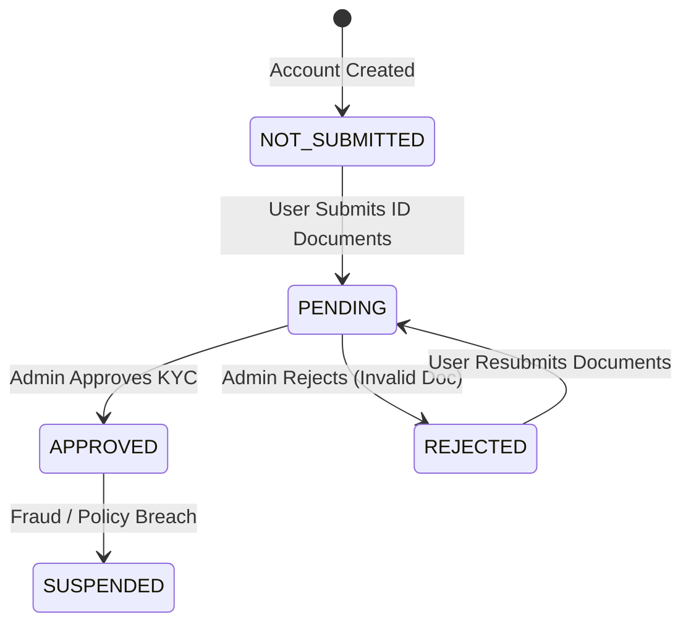

# 03. User Profiles & KYC Verification

## Overview
WorkNest maintains distinct profile entities for clients and freelancers linked to the central `User` model. Additionally, an identity verification (KYC) state machine enables the platform to comply with financial regulations and build trust between parties prior to high-value escrow transactions.

---

## Key Files & Modules
- `src/server/services/profile.service.ts`: Profile creation, skill tagging, rate settings, and reputation calculation.
- `src/app/(dashboard)/client/profile/page.tsx`: Client company profile management.
- `src/app/(dashboard)/freelancer/profile/page.tsx`: Freelancer public portfolio, hourly rate, and bio.
- `src/app/clients/[id]/page.tsx` & `src/app/freelancers/[id]/page.tsx`: Publicly viewable profile pages.
- `src/app/admin/users/page.tsx`: Administrator directory for user status toggles and KYC verification actions.

---

## Data Model & Verification States

- **KYC Statuses**:
  - `NOT_SUBMITTED`: Default state upon signup.
  - `PENDING`: User uploaded identity credentials or requested verification.
  - `APPROVED`: Admin verified the legal identity; profile receives a verified badge.
  - `REJECTED`: Documentation failed verification; user is prompted to resubmit.
- **User Account Statuses**:
  - `ACTIVE`: Normal operating privileges.
  - `SUSPENDED`: User blocked from bidding, posting jobs, or initiating escrow payouts.
  - `DEACTIVATED`: Voluntary account closure.

---

## End-to-End Use Cases

### Use Case 3.1: Freelancer Profile Setup & Skill Tagging
- **Actor**: Freelancer
- **Workflow**:
  1. Freelancer navigates to `/freelancer/profile`.
  2. Sets professional headline (e.g., "Full-Stack Next.js & Solana Architect").
  3. Sets hourly rate in USD cents ($85.00 -> `8500`).
  4. Selects skill tags from the platform taxonomy (`Next.js`, `TypeScript`, `PostgreSQL`, `TailwindCSS`).
  5. Profile is instantly updated and rendered on the public `/freelancers/[id]` showcase.

### Use Case 3.2: Administrative KYC Verification
- **Actor**: Super Admin
- **Workflow**:
  1. Super Admin navigates to `/admin/users`.
  2. Locates a user currently marked with a yellow `PENDING` KYC badge.
  3. Clicks **Verify KYC**.
  4. Sonner fires an optimistic toast spinner (`Updating KYC status...`).
  5. The server action updates `user.kycStatus = "APPROVED"` and logs the action to the audit trail.
  6. Sonner displays a green confirmation toast (`KYC approved successfully`).
  7. The user now displays a blue verified shield icon next to their name platform-wide.

### Use Case 3.3: Risk Mitigation & User Suspension
- **Actor**: Super Admin
- **Workflow**:
  1. A user is reported for violating marketplace policies.
  2. Admin navigates to `/admin/users` and locates the user.
  3. Clicks **Suspend User**.
  4. User status is immediately set to `SUSPENDED`.
  5. NextAuth session middleware terminates their active sessions, preventing further job creation or bid submissions.

