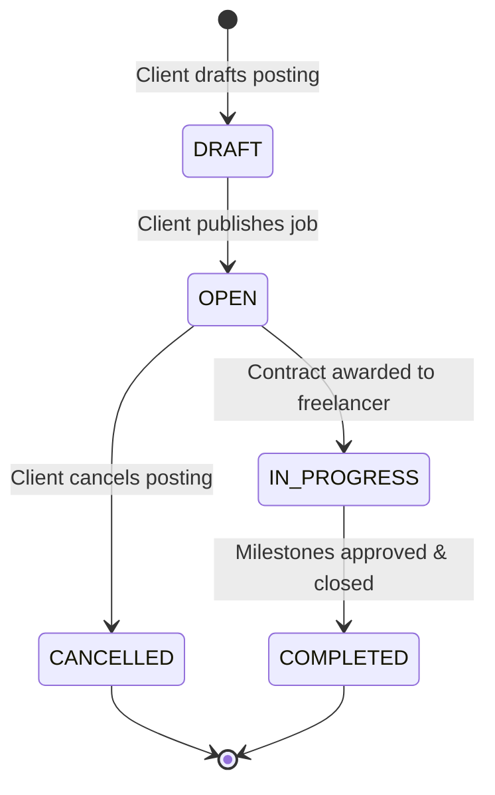

# 04. Job Marketplace & Search

## Overview
The Job Marketplace module enables clients to draft, publish, and manage job listings, while providing freelancers with high-performance discovery tools (full-text search, budget ranges, payment types, and required skill tags).

---

## Key Files & Modules
- `src/server/services/job.service.ts`: Job creation, updating, search queries, status transitions, and proposal count aggregations.
- `src/app/jobs/page.tsx`: Public marketplace directory with interactive filters.
- `src/app/jobs/[id]/page.tsx`: Detailed job view showing client history, budget, scope, and proposal submission trigger.
- `src/app/(dashboard)/client/jobs/new/page.tsx`: Client wizard for publishing new opportunities.
- `src/app/(dashboard)/client/jobs/page.tsx`: Client management board for active, draft, and closed jobs.

---

## Job State Lifecycle

---

## Key Features & Schema Invariants

1. **Dual Payment Structures**:
   - `FIXED_PRICE`: Project with defined budget in integer cents (e.g., $1,500.00 = `150000`).
   - `HOURLY`: Project with expected hourly rate range and estimated weekly hours.
2. **Experience Levels**:
   - `ENTRY`, `INTERMEDIATE`, `EXPERT`.
3. **Faceted Filtering**:
   - Filter by keyword search across title and description.
   - Filter by skill tags (`React`, `Python`, `Design`, etc.).
   - Filter by minimum / maximum budget range.
   - Filter by experience tier.
4. **Proposal Counter Invariant**:
   - Each job maintains real-time proposal counters without exposing competitor bid amounts to rival freelancers.
5. **Budget Modification Safeguard**:
   - Once proposals have been submitted on a job (`job.proposalsCount > 0`), clients are prohibited from reducing the budget (`CANNOT_REDUCE_BUDGET_WITH_PROPOSALS`), protecting proposers from bait-and-switch tactics.
6. **Freelancer Bookmark & Save Mechanism**:
   - Freelancers can bookmark/save jobs (`SavedJob` model) to track opportunities across devices with instant optimistic UI feedback.
7. **Community Moderation Flagging**:
   - Freelancers can report suspicious listings directly to the Trust & Safety team via `ReportJobModal`.

---

## End-to-End Use Cases

### Use Case 4.1: Client Creates and Publishes a Job
- **Actor**: Enterprise Client
- **Workflow**:
  1. Client visits `/client/jobs/new`.
  2. Enters job title: "High-Throughput Double-Entry Ledger Engineer".
  3. Selects category: `SOFTWARE_ENGINEERING`.
  4. Selects budget type: `FIXED_PRICE` and specifies `$3,500.00` budget.
  5. Selects experience tier: `EXPERT`.
  6. Adds tags: `TypeScript`, `Prisma`, `PostgreSQL`, `Next.js`.
  7. Clicks **Publish Job**.
  8. Job status becomes `OPEN`, and the posting immediately appears in the public `/jobs` marketplace.

### Use Case 4.2: Freelancer Discovers, Evaluates, and Bookmarks an Opportunity
- **Actor**: Freelancer
- **Workflow**:
  1. Freelancer navigates to `/jobs`.
  2. Searches for "Ledger" and filters by `FIXED_PRICE` with budget > `$2,000`.
  3. Selects the posting to open `/jobs/[id]`.
  4. Inspects client hiring history: total spend, rating, and verified payment badge.
  5. Clicks the **Save Job** button to bookmark the listing for later review.
  6. Decides to pitch and clicks **Apply Now**.

### Use Case 4.3: Community Report of Misleading Listing
- **Actor**: Freelancer
- **Workflow**:
  1. Freelancer reads a job description asking to communicate and pay off-platform via Telegram.
  2. Clicks **Report this job** on `/jobs/[id]`.
  3. In the modal, enters reason: *"Client attempting to bypass platform escrow and take payments off-platform."*
  4. Submits the report; Sonner confirms submission.
  5. An urgent ticket is immediately routed to the Admin Moderation Queue (`/admin/reports`).

