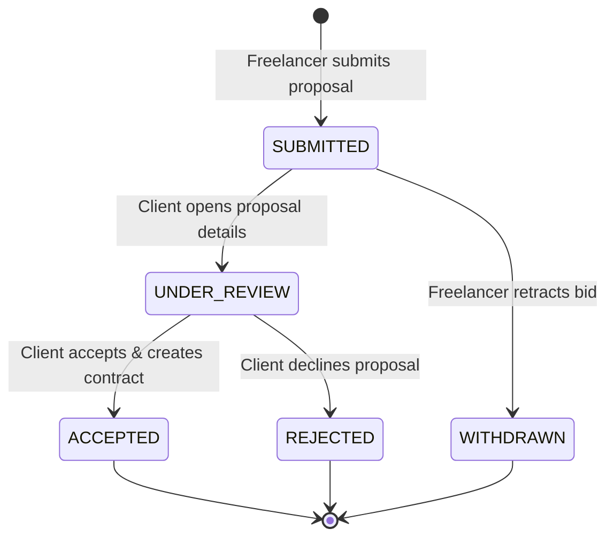

# 05. Proposals & Bidding System

## Overview

The Proposals module allows qualified freelancers to submit competitive pitches, breakdown deliverable milestones, and negotiate pricing with clients. Clients receive submissions through a dedicated proposal review desk where they can compare candidates, review past performance, and award contracts with 1 click.

---

## Key Files & Modules

- `src/server/services/proposal.service.ts`: Proposal submission, duplicate check validation, milestone formatting, and status transitions.
- `src/app/jobs/[id]/apply/page.tsx`: Freelancer proposal submission form.
- `src/app/(dashboard)/client/jobs/[id]/proposals/page.tsx`: Client proposal review desk.
- `src/app/(dashboard)/freelancer/proposals/page.tsx`: Freelancer proposal management board tracking active pitches.

---

## Proposal State Lifecycle

---

## Capabilities & Business Rules

1. **One Active Proposal Per Freelancer Per Job**:
   - The database enforces uniqueness on `[jobId, freelancerId]` to prevent spamming duplicate bids.
2. **Milestone Schedule Breakdown**:
   - Proposals can include structured milestone proposals (e.g., Milestone 1: Design ($500), Milestone 2: Implementation ($1,500), Milestone 3: QA ($500)).
3. **Cover Letter & Estimated Timeline**:
   - Freelancer specifies projected turnaround time (e.g., `< 1 month`, `1 to 3 months`).
4. **Platform Take Estimation**:
   - System displays the estimated platform service fee and net take-home pay to the freelancer in real time before submission.

---

## End-to-End Use Cases

### Use Case 5.1: Freelancer Submits a Detailed Proposal

- **Actor**: Freelancer
- **Workflow**:
  1. Freelancer navigates to `/jobs/[id]/apply`.
  2. Writes a targeted cover letter outlining past relevant projects.
  3. Proposes total bid amount: `$2,500.00`.
  4. Outlines milestones:
     - Milestone 1: Architecture RFC & Database Schema ($500)
     - Milestone 2: API & Core Logic ($1,200)
     - Milestone 3: Test Suite & Production Rollout ($800)
  5. Reviews net earnings preview (Gross $2,500.00 minus 10% platform fee = $2,250.00).
  6. Clicks **Submit Proposal**.
  7. Client receives an in-app notification of the new bid.

### Use Case 5.2: Client Evaluates Proposals & Awards Contract

- **Actor**: Client
- **Workflow**:
  1. Client navigates to `/client/jobs/[id]/proposals`.
  2. Views all applicant cards sorted by submission date and freelancer rating.
  3. Clicks on the applicant's profile to view portfolio and client feedback ratings.
  4. Clicks **Accept Proposal & Create Contract**.
  5. The server creates a formal `Contract` entity with draft milestones matching the proposal breakdown.
  6. Status of the selected proposal transitions to `ACCEPTED`, while remaining proposals can be respectfully set to `REJECTED`.
