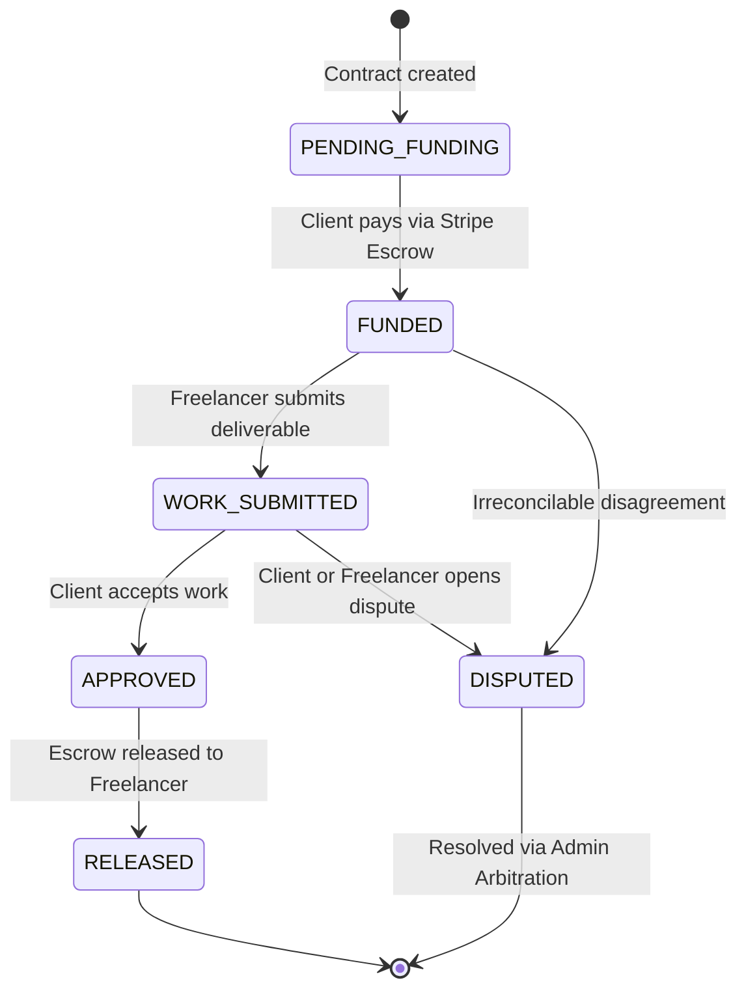

# 06. Contracts & Milestone Escrow

## Overview

WorkNest operates on a **Milestone Escrow Architecture**. When a contract is established, clients fund individual milestones before work begins. Funds are held securely in escrow and only released to the freelancer upon client approval or automated review expiration. All calculations use integer minor units (cents) to avoid any IEEE-754 floating-point errors.

---

## Key Files & Modules

- `src/server/services/contract.service.ts`: Contract creation, milestone management, submission workflows, milestone approval, and escrow release.
- `src/server/services/payment.service.ts`: Stripe Checkout sessions for escrow funding, webhook listeners, and transfer intent management.
- `src/app/(dashboard)/contracts/[id]/page.tsx`: Contract command center for both client and freelancer with progress tracker and feedback ratings.
- `src/app/(dashboard)/contracts/[id]/loading.tsx`: Streaming shimmering skeleton for smooth contract loading.
- `src/app/(dashboard)/client/contracts/page.tsx`: Client contract portfolio with milestone progress bars.
- `src/app/(dashboard)/freelancer/contracts/page.tsx`: Freelancer active assignments with deliverable submissions.

---

## Milestone State Lifecycle



---

## Financial Precision & Escrow Mechanics

1. **Integer Minor Units**:
   - Every monetary property is stored as integer cents:
     ```typescript
     // $1,250.00 is stored as 125000 cents
     amountCents: 125000;
     ```
2. **Escrow Holding Guarantee**:
   - When a milestone is marked `FUNDED`, funds move from the client into the platform's escrow trust account. The freelancer is notified that funding is verified, making it safe to begin work.
3. **Double-Entry Journaling**:
   - Each state transition triggers a corresponding transaction in the double-entry ledger (see [07. Double-Entry Financial Ledger](./07-double-entry-ledger.md)).

---

## End-to-End Use Cases

### Use Case 6.1: Client Funds Milestone 1 via Stripe Escrow

- **Actor**: Client
- **Workflow**:
  1. Client navigates to `/contracts/[id]`.
  2. Identifies Milestone 1: "Database Schema & API Foundation" ($1,000.00 / `100000` cents).
  3. Clicks **Fund Escrow**.
  4. Server creates a Stripe Checkout session pre-configured with metadata (`contractId`, `milestoneId`, `type: ESCROW_FUND`).
  5. Client enters payment card details on Stripe Checkout and completes payment.
  6. Stripe triggers webhook `/api/webhooks/stripe` (`checkout.session.completed`).
  7. Server verifies webhook signature, transitions milestone to `FUNDED`, and writes ledger entries crediting escrow.
  8. Freelancer receives notification: _"Milestone 1 funded - Safe to proceed with development"_.

### Use Case 6.2: Freelancer Submits Deliverable

- **Actor**: Freelancer
- **Workflow**:
  1. Freelancer completes work on Milestone 1.
  2. Opens `/contracts/[id]` and clicks **Submit Work for Approval**.
  3. Provides deliverable URL (e.g., GitHub pull request, staging link) and detailed completion notes.
  4. Milestone status transitions to `WORK_SUBMITTED`.
  5. The 14-day auto-approval timer initiates (monitored by the daily background cron).

### Use Case 6.3: Client Approves Work & Releases Escrow

- **Actor**: Client
- **Workflow**:
  1. Client reviews submitted deliverables on `/contracts/[id]`.
  2. Satisfied with work, clicks **Approve & Release Funds**.
  3. Server transitions milestone status to `APPROVED` then `RELEASED`.
  4. Platform deducts 10% platform fee and credits the remaining 90% to the Freelancer's payable ledger balance.
  5. Contract overall progress bar updates. If all milestones are released, contract marks as `COMPLETED`.
