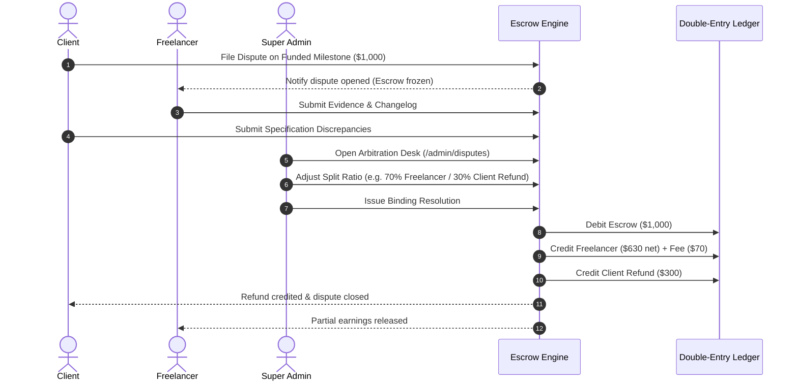

# 08. Disputes & Platform Moderation

## Overview
Disputes and platform moderation safeguard trust and safety across the ecosystem. When deliverables fail to meet agreed specifications or parties reach an impasse, either party can open a formal dispute on a funded milestone. Super Admins arbitrate disputes using an interactive judicial tool with custom split ratios. Additionally, users can flag inappropriate jobs, messages, or profiles for community moderation.

---

## Key Files & Modules
- `src/server/services/dispute.service.ts`: Dispute initiation, evidence submission, resolution calculation, and ledger settlement.
- `src/app/admin/disputes/page.tsx`: Judicial arbitration dashboard with open claims.
- `src/components/admin/dispute-resolver.tsx`: Interactive judicial modal with split ratio slider, refund calculations, and toast notifications.
- `src/app/admin/reports/page.tsx`: Community moderation queue for flagged content.
- `src/components/admin/report-status-button.tsx`: 1-click resolve/dismiss controls with optimistic feedback.

---

## Dispute Lifecycle & Judicial Arbitration Flow

---

## Capabilities & Governance Features

1. **Frozen Escrow Guarantee**:
   - The moment a dispute transitions to `OPEN`, automated milestone release timers are halted, preventing unauthorized release or withdrawal.
2. **Interactive Split Ratio Slider**:
   - Rather than forcing an all-or-nothing binary decision, administrators can dial any custom split from 0% to 100% in 5% increments.
   - Dynamic real-time calculation displays the exact dollar amounts allocated to the Freelancer, Client Refund, and Platform Fee before confirmation.
3. **Binding Judicial Resolution**:
   - Resolving a dispute executes atomic database transactions updating milestone statuses, generating double-entry ledger entries, and notifying both parties.
4. **Community Content Moderation**:
   - Reports on suspicious jobs, fraudulent clients, or harassment are categorized into an administrative queue with 1-click `RESOLVED` or `DISMISSED` actions.

---

## End-to-End Use Cases

### Use Case 8.1: Client Files a Formal Dispute
- **Actor**: Client
- **Workflow**:
  1. Freelancer submits work for Milestone 2.
  2. Client notes that critical features are absent and freelancer is unresponsive to revision requests.
  3. Client clicks **Open Dispute** on `/contracts/[id]`.
  4. Selects dispute reason: `UNSATISFACTORY_WORK`.
  5. Enters description and uploads documentation.
  6. Milestone status transitions to `DISPUTED`, escrow is frozen, and an alert is routed to the Admin Arbitration Desk.

### Use Case 8.2: Admin Arbitrates with Split Ratio Modal
- **Actor**: Super Admin
- **Workflow**:
  1. Admin opens `/admin/disputes`.
  2. Reviews claim details: contract value ($1,000.00), client statement, and freelancer deliverable links.
  3. Clicks **Arbitrate Case**.
  4. In the modal, adjusts the split ratio slider to **70% Freelancer / 30% Client**:
     - *Freelancer Payout*: $630.00 (after 10% fee)
     - *Client Refund*: $300.00
     - *Platform Commission*: $70.00
  5. Adds resolution ruling: *"Freelancer completed 70% of scope; client compensated for incomplete QA."*
  6. Clicks **Confirm Resolution**.
  7. Sonner toast confirms resolution; ledger entries balance escrow to zero; contract resumes.

### Use Case 8.3: Moderating a Flagged Job Listing
- **Actor**: Super Admin
- **Workflow**:
  1. Admin opens `/admin/reports`.
  2. Sees report: "Phishing attempt asking for external Telegram communication".
  3. Reviews reported job link.
  4. Clicks **Resolve Report**.
  5. The report is marked resolved, and admin can click the associated user link to suspend the fraudulent account.

