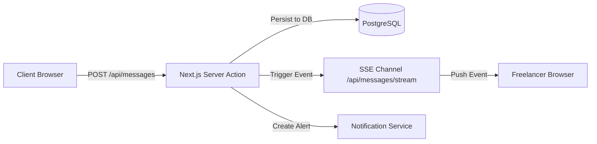

# 09. Real-Time Messaging & Notifications

## Overview
WorkNest provides contextual direct messaging between clients and freelancers tied directly to active proposals and contracts, alongside an asynchronous notifications system. Real-time updates utilize lightweight **Server-Sent Events (SSE)** without requiring costly third-party WebSocket server infrastructure.

---

## Key Files & Modules
- `src/server/services/messaging.service.ts`: Thread creation, message dispatch, attachment handling, and unread count tracking.
- `src/server/services/notification.service.ts`: In-app notification creation, badge counters, and read state persistence.
- `src/server/actions/notification.actions.ts`: Server actions for `markNotificationReadAction` and `markAllNotificationsReadAction`.
- `src/components/forms/mark-notifications-read-button.tsx`: 1-click batch read acknowledgment with optimistic toast feedback.
- `src/app/(dashboard)/messages/page.tsx`: Conversation inbox and message thread views.
- `src/app/(dashboard)/notifications/page.tsx`: System notification feed with unread indicators and bulk actions.
- `src/components/chat/`: Chat input, message bubbles, timestamp formatting, and optimistic message rendering.

---

## Architecture Flow

---

## Capabilities & Features

1. **Context-Linked Conversations**:
   - Every chat thread can optionally link directly to a `Job`, `Proposal`, or `Contract`, keeping commercial discussions anchored to legal milestones.
2. **Real-time Live Updates**:
   - Uses Server-Sent Events (SSE) to push incoming messages into active thread windows without browser reloading.
3. **Unread Badges & Read Receipts**:
   - Navigation bars show badge counters that clear automatically when an active conversation is opened.
4. **Rich Notifications**:
   - Instant in-app alerts for key platform lifecycle events:
     - New proposal submitted
     - Proposal accepted / contract drafted
     - Milestone funded into escrow
     - Deliverable submitted for approval
     - Milestone approved & funds released
     - Dispute filed / resolved

---

## End-to-End Use Cases

### Use Case 9.1: Direct Messaging During Active Contract
- **Actor**: Client & Freelancer
- **Workflow**:
  1. Client navigates to `/contracts/[id]` and clicks **Open Conversation**.
  2. Types an implementation clarification: *"Please make sure the API response adheres to OpenAPI 3.1 schema"*.
  3. Clicks Send.
  4. Freelancer, who has `/messages` open, sees the new message bubble appear in real time via SSE without manual refresh.
  5. Freelancer replies with code sample and documentation link.

### Use Case 9.2: System Lifecycle Notification
- **Actor**: Freelancer
- **Workflow**:
  1. Client funds Milestone 1 via Stripe Checkout.
  2. Stripe webhook handler calls `notificationService.createNotification()`:
     - *Title*: "Milestone Funded"
     - *Message*: "Client has funded Milestone 1 ($1,000.00). You may now begin work."
     - *Link*: `/contracts/[id]`
  3. Freelancer sees the notification bell badge increment from 0 to 1.
  4. Clicking the bell displays the notification dropdown; clicking the notification routes directly to the contract.

