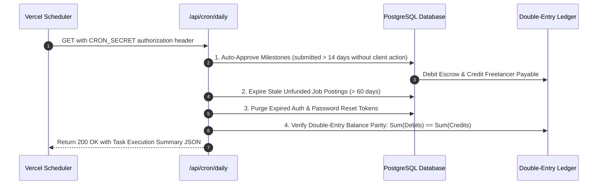

# 11. Background Automation & Daily Cron

## Overview

Marketplace platforms require recurring maintenance jobs: auto-approving milestones when clients do not respond within review windows, expiring stale job drafts, cleaning up orphaned sessions, and performing cryptographic ledger reconciliations. To comply with Vercel's Hobby Tier limitation (exactly **one daily cron** per deployment), all automation tasks are unified into a single daily master runner at `/api/cron/daily`.

---

## Key Files & Modules

- `vercel.json`: Single cron configuration scheduled daily at `0 0 * * *`.
- `src/app/api/cron/daily/route.ts`: Master orchestrator running sequential maintenance tasks.
- `src/server/services/cron.service.ts`: Core background domain tasks:
  - `autoApproveMilestones()`: Auto-release milestones after review window.
  - `reconcileLedgerDaily()`: Verify debit/credit balance equality.
  - `cleanupExpiredTokens()`: Purge expired password reset and verification tokens.
  - `expireStaleJobs()`: Archive inactive job postings past expiration.

---

## Vercel Hobby-Compliant Configuration

```json
{
  "crons": [
    {
      "path": "/api/cron/daily",
      "schedule": "0 0 * * *"
    }
  ]
}
```

> [!IMPORTANT]
> Vercel Hobby accounts reject deployments containing multi-minute cron schedules (such as `* * * * *` or `*/5 * * * *`) with error:
> _"Hobby accounts are limited to daily cron jobs."_
> WorkNest consolidates all background jobs into `/api/cron/daily`, with internal tasks executing sequentially within a single protected request.

---

## Master Cron Execution Sequence



---

## Security & Protection

- **CRON_SECRET Authentication**:
  - The endpoint verifies the incoming `Authorization: Bearer <CRON_SECRET>` header to prevent unauthorized public execution.
- **PostgreSQL Advisory Locking (`withCronAdvisoryLock`)**:
  - Uses `pg_try_advisory_lock(9999)` so overlapping cron runs or multi-region trigger retries are blocked immediately (`HTTP 429`), preventing race conditions and duplicate transaction processing.
- **Fail-Safe Transaction Isolation**:
  - Each task executes in its own isolated `try/catch` block. If token cleanup fails, ledger reconciliation and milestone approval still run and report their individual outcomes.

---

## Security & Performance Checklist (Phase 9 Audit)

1. **Security Headers**:
   - `Strict-Transport-Security: max-age=63072000; includeSubDomains; preload`
   - `X-Frame-Options: DENY` (Clickjacking prevention)
   - `X-Content-Type-Options: nosniff` (MIME sniffing prevention)
   - `Referrer-Policy: strict-origin-when-cross-origin`
   - `Permissions-Policy: camera=(), microphone=(), geolocation=()`
   - `Cache-Control: no-store` on all API endpoints
2. **Cryptographic Integrity**:
   - Integer minor units (`BigInt` / cents) for all currencies
   - Double-entry ledger parity verified automatically every night
   - Argon2id password hashing with random salt
   - Sensitive columns encrypted with AES-256-GCM
3. **Database Performance**:
   - Compound indexes on query hotpaths (`[status, publishedAt]`, `[userId, createdAt]`)
   - Cursor-based pagination avoiding expensive `OFFSET` overhead on large tables
   - All foreign keys indexed with explicit `onDelete` cascades/restrictions

---

## End-to-End Use Cases

### Use Case 11.1: Automatic Milestone Approval

- **Actor**: Freelancer
- **Scenario**: Freelancer submitted completed work on a $2,000 milestone 14 days ago. The client went on leave and did not review or reject the deliverable.
- **Workflow**:
  1. The daily cron triggers at 00:00 UTC.
  2. `autoApproveMilestones()` finds the milestone with status `WORK_SUBMITTED` and `submittedAt <= Date.now() - 14 days`.
  3. The system transitions milestone status to `APPROVED` and executes escrow release.
  4. Freelancer is credited $1,800.00 net, platform collects $200.00 fee.
  5. Both client and freelancer receive email notification of automatic completion.

### Use Case 11.2: Cryptographic Ledger Parity Check

- **Actor**: Automated System
- **Scenario**: Validate zero drift across all historical financial records.
- **Workflow**:
  1. During the daily cron run, `reconcileLedgerDaily()` aggregates all historical `DEBIT` entries and `CREDIT` entries.
  2. Total debits: `$452,100.00`
  3. Total credits: `$452,100.00`
  4. Discrepancy: `$0.00`
  5. Status logged as `HEALTHY`.
