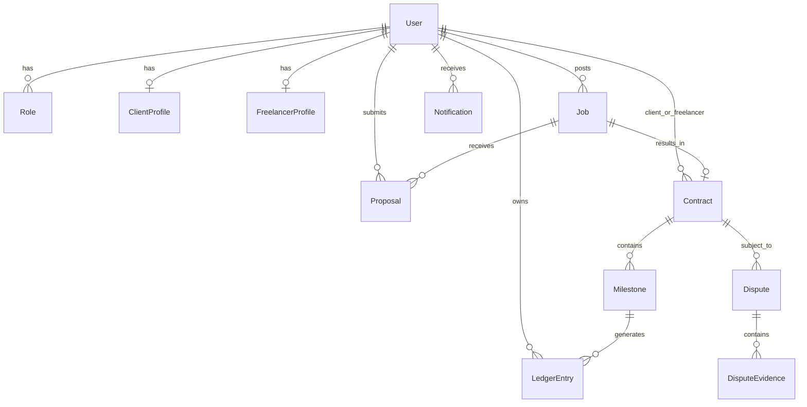

# 12. Database Schema & Data Seeding

## Overview
WorkNest uses **PostgreSQL** (hosted on Neon Serverless) managed through **Prisma ORM**. The schema is designed for strict referential integrity, cascading updates, enum-driven state machines, and immutable audit logs. It also includes an idempotent data seeder (`prisma/seed.ts`) that provisions pre-populated demo records and self-heals empty database environments on login.

---

## Key Files & Modules
- `prisma/schema.prisma`: Complete Prisma schema definition, models, relations, and enums.
- `prisma/seed.ts`: Standalone seed script written in TypeScript executed via `tsx` or `npm run db:seed`.
- `src/server/services/auth.service.ts`: Self-healing seed hook that auto-populates the database if 0 users exist upon login attempt.
- `src/components/admin/seed-database-button.tsx`: 1-click on-demand database sync button in the admin topbar.

---

## Core Schema Entity Relationship



---

## Schema Highlights

### 1. Unified User & RBAC Model
```prisma
model User {
  id            String       @id @default(cuid())
  email         String       @unique
  name          String?
  passwordHash  String
  roles         Role[]       @default([CLIENT])
  status        UserStatus   @default(ACTIVE)
  kycStatus     KycStatus    @default(NOT_SUBMITTED)
  createdAt     DateTime     @default(now())
  updatedAt     DateTime     @updatedAt
  // Relations
  clientProfile ClientProfile?
  freelancerProfile FreelancerProfile?
}
```

### 2. Contract & Milestone Escrow Model
```prisma
model Milestone {
  id             String          @id @default(cuid())
  contractId     String
  contract       Contract        @relation(fields: [contractId], references: [id])
  title          String
  amountCents    Int             // Strict integer cents ($1,000.00 = 100000)
  status         MilestoneStatus @default(PENDING_FUNDING)
  deliverableUrl String?
  deliverableNotes String?
  submittedAt    DateTime?
  approvedAt     DateTime?
}
```

### 3. Cryptographic Double-Entry Ledger Model
```prisma
model LedgerEntry {
  id           String        @id @default(cuid())
  userId       String
  user         User          @relation(fields: [userId], references: [id])
  contractId   String?
  contract     Contract?     @relation(fields: [contractId], references: [id])
  milestoneId  String?
  milestone    Milestone?    @relation(fields: [milestoneId], references: [id])
  accountType  AccountType   // ESCROW_HOLDING, FREELANCER_PAYABLE, etc.
  entryType    EntryType     // DEBIT or CREDIT
  amountCents  Int           // Minor units
  description  String
  createdAt    DateTime      @default(now())
}
```

---

## Seed Data & Test Accounts

The seed script (`prisma/seed.ts`) idempotently creates:

1. **Super Admin Persona**:
   - Email: `admin@worknest.dev`
   - Password: `Admin@123456`
   - Role: `ADMIN`
   - KYC Status: `APPROVED`
2. **Enterprise Client Persona**:
   - Email: `client@worknest.dev`
   - Password: `Client@123456`
   - Role: `CLIENT`
   - Company: "Acme Cloud Infrastructure"
   - Active Jobs: 3 posted jobs (Next.js Architect, Rust Systems, UI/UX Designer)
3. **Senior Freelancer Persona**:
   - Email: `freelancer@worknest.dev`
   - Password: `Freelancer@123456`
   - Role: `FREELANCER`
   - Rate: $95/hr (`9500` cents)
   - Verified KYC: `APPROVED`
   - Active Contracts: 1 funded contract with 3 milestones ($1,500, $2,500, $1,000)
4. **Active Dispute & Moderation Reports**:
   - 1 open dispute with client statement and deliverable evidence ready for arbitration.
   - 2 flagged community reports ready for moderation.
5. **Initial Double-Entry Ledger Entries**:
   - Balanced debits and credits demonstrating funded escrow and fee retention.

---

## How to Run Seed

### Local Development / CLI
```bash
pnpm db:seed
```

### Self-Healing Auto-Seed on Vercel
When deploying to a brand-new Neon database on Vercel, simply navigate to `/login` and sign in with any of the demo accounts above. If the database has 0 users, the authentication service automatically invokes `seedDatabase()` on the fly, populating all tables and letting you log in immediately.

### On-Demand Seed via Admin Topbar
From within the Admin Console (`/admin`), Super Admins can click the **Sync Demo Data** button in the sticky topbar to reset or replenish demo fixtures at any time with real-time Sonner toast progress.

