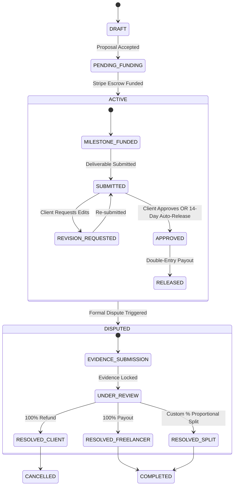

# 02. Core Value Propositions & Unfair Moats

To displace legacy incumbents, WorkNest builds upon **five structural and architectural moats** that legacy platforms cannot easily replicate without breaking their existing monetization models.

---

## 1. The Economic Moat: "Zero-Connects, 100% Signal"

### The Incumbent Trap

Upwork generated over \$100M+ in 2024 solely by selling digital "Connects" to freelancers. This creates an unaligned perverse incentive: **the platform profits most when freelancers apply to jobs they don't win.** This flooding of 60+ bids per job forces clients to use AI filters that discard qualified candidates.

### WorkNest's Structural Advantage

- **Zero Pay-to-Bid Tax:** Freelancers NEVER pay to apply for jobs.
- **Dynamic Bidding Caps (Quality over Quantity):** Instead of monetizing applications, WorkNest caps active proposals at 5 concurrent bids for unverified talent and 15 for verified talent. When a proposal is closed or rejected, the slot frees up.
- **Algorithmic Match Scoring:** Rather than allowing freelancers to "boost" bids with cash, proposals are ranked strictly by skill overlap, verified deliverable track record, and relevance.
- **Fair 5% Transparent Take Rate:** We cut the traditional 10%–20% fee in half, returning 5%–15% more net income directly to talent.

---

## 2. The Architectural Moat: Cryptographic Double-Entry Financial Telemetry

### The Problem in Existing Marketplaces

Neither Upwork nor Fiverr provides mathematical proof of escrow state. Funds sit in aggregated corporate holding accounts, and discrepancies are resolved by customer service agents reviewing unstructured internal logs.

### WorkNest's Implementation

- **Double-Entry Ledger (`LedgerEntry`):** Every cent that moves between Client Escrow, Platform Fee Retainers, and Freelancer Payouts writes an immutable, balanced ledger pair.
- **Strict Integer Math:** All operations are computed in integer minor cents (`BigInt`), completely eliminating IEEE 754 floating-point rounding drift.
- **Automated Nightly Reconciliation:** Our daily cron (`/api/cron/daily`) executes a ledger balance invariant check:
  $$\sum \text{ESCROW\_FUND} = \sum \text{ESCROW\_RELEASE} + \sum \text{ESCROW\_REFUND} + \sum \text{ESCROW\_HOLDING}$$
  Any deviation of even \$0.01 triggers immediate admin alerts, guaranteeing audit-ready enterprise compliance.

---

## 3. The Trust & Safety Moat: Deterministic Escrow State Machine

### Deterministic Guarantees:

1. **14-Day Inactivity Safe-Release:** If a client goes unresponsive after deliverable submission, escrow automatically releases to the freelancer. No client can hold work hostage through silence.
2. **Three-Way Judicial Arbitration:** Unlike binary "win/lose" platforms, our admin console allows custom split rulings (e.g. 70% to freelancer for partial work, 30% refund to client), ending the all-or-nothing adversarial dynamic.
3. **Evidence Lockers:** When a dispute is filed, messaging and milestone states freeze, capturing a cryptographically sealed snapshot of code, chat logs, and delivery timestamps.

---

## 4. The Developer Experience Moat: Verifiable Proof of Work (GitHub / GitLab Integration)

### The Problem in Legacy Platforms

Software engineers must upload zip files, PDFs, or screenshots to demonstrate deliverable completion. Clients have no automated way to verify test coverage, lint cleanliness, or whether the code matches the agreed milestones.

### WorkNest Innovation: Native Git Milestones

- **Pull Request Binding:** A freelancer binds a GitHub/GitLab Pull Request URL directly to a milestone deliverable.
- **Automated Deliverable Telemetry:**
  - Pull Request status (Open, Merged, CI/CD build passing).
  - Lines added/removed diff preview directly inside the WorkNest Contract Room.
  - Automated detection of test suite status (GitHub Actions green checkmark badge).
- **Verifiable Reputation:** Upon completion, verified commit hashes become permanent, cryptographic work credentials on the freelancer's public profile, replacing easily faked text testimonials.

---

## 5. The Unified Persona Moat: Single Account Dual-Role Fluidity

### Friction in Incumbent Marketplaces

On Upwork, switching between client and freelancer requires maintaining awkward sub-teams and dropdowns that often lead to cross-account lockout or accidental postings.

### WorkNest Implementation

- **First-Class Dual Identity:** A single WorkNest user can post a design job as a client in the morning and submit a backend architecture proposal as a freelancer in the afternoon.
- **Unified Financial Ledger:** Client escrow payments and freelancer earnings are tracked under a single, reconciled tax and accounting profile.
- **Instant Role-Switching:** Clean workspace transition in the top navigation bar without logging out or managing multiple credentials.
