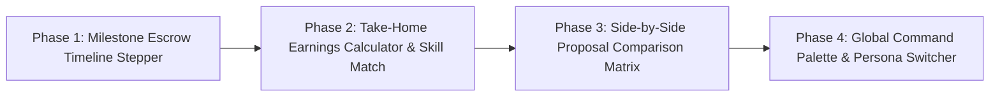

# 04. Frontend & Client / Freelancer UI/UX Enhancement Roadmap

## 🎯 Strategic Objective

WorkNest already leads on technical foundations (cryptographic double-entry ledger, zero-connects matching, GitHub PR verification, and WebRTC huddles). This roadmap delivers a **consumer-grade, high-density, ergonomic UI/UX experience** that rivals Linear, Stripe, and Contra, eliminating cognitive friction for both hiring clients and elite contractors.

---

## 🗺️ UI/UX Enhancement Phases

---

### Phase 1: Visual Milestone Escrow Timeline & Progress Stepper

- **Target Route**: `/contracts/[id]`
- **UX Goal**: Give clients and freelancers an instant visual understanding of milestone lifecycle, released vs escrowed funds, and next actionable steps.
- **Component**: `<ContractTimelineStepper />`
- **Features**:
  - Horizontal progress stage stepper (`Funded` ➔ `In Progress` ➔ `Submitted` ➔ `Released`).
  - Escrow capital status bar with total contract value, funded amount, and completed percentage.
  - Quick-navigation jump links to active milestone review sections.

---

### Phase 2: Transparent Take-Home Earnings Calculator & Skill Match Badges

- **Target Routes**: `/jobs`, `/jobs/[id]`, `/jobs/[id]/apply`
- **UX Goal**: Empower freelancers with instant clarity on net take-home earnings (highlighting 0% platform take-rate savings over Upwork's 10%) and job skill suitability.
- **Components**:
  - `<EarningsCalculator />` inside Proposal Submission Form.
  - `<JobFitBadge />` displaying matching skills vs missing requirements.

---

### Phase 3: Interactive Side-by-Side Proposal Comparison Matrix

- **Target Route**: `/client/jobs/[id]/proposals`
- **UX Goal**: Remove tab-switching fatigue for hiring managers evaluating candidate pitches.
- **Component**: `<ProposalComparisonMatrix />`
- **Features**:
  - Select up to 3 candidate proposals to compare side-by-side.
  - Compare bid rate, proposed milestones, delivery timeline, and verified rating.
  - 1-click shortlist and direct contract initiation.

---

### Phase 4: Global Command Palette (`Cmd + K`) & Unified Persona Switcher

- **Target Route**: Global Dashboard Layout (`src/app/(dashboard)/layout.tsx`)
- **UX Goal**: Provide power-user keyboard navigation across contracts, jobs, and messages, paired with an elegant segmented persona switcher (`Client Mode` ⇄ `Freelancer Mode`).
- **Components**:
  - `<CommandPalette />` (`Cmd+K` / `Ctrl+K`)
  - `<PersonaSwitcher />`

---

## 📊 Phase Implementation Tracking

| Phase  | Module / Feature                          | Primary Audience | Status         |
| :----- | :---------------------------------------- | :--------------- | :------------- |
| **P1** | Milestone Escrow Timeline Stepper         | Client & Talent  | ✅ Shipped     |
| **P2** | Earnings Calculator & Skill Match Radar   | Freelancers      | ✅ Shipped     |
| **P3** | Side-by-Side Proposal Comparison Matrix   | Clients          | 🟡 In Progress |
| **P4** | Global Command Palette & Persona Switcher | All Users        | ⚪ Scheduled   |
