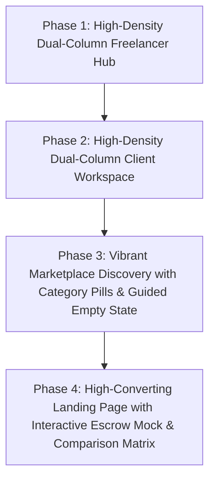

# 05. Visual & UI/UX Design Overhaul (Landing, Marketplace & Dual-Column Hubs)

## 🎨 Visual Diagnosis & Competitor Teardown

Based on visual review of the live deployment (`xcs-job-portal.vercel.app`):

| Page View                          | Current Visual Shortcoming                                                                                      | Competitor Benchmark (Contra, Linear, Upwork, Stripe)                                                                                            | Proposed Overhaul                                                                                                                         |
| :--------------------------------- | :-------------------------------------------------------------------------------------------------------------- | :----------------------------------------------------------------------------------------------------------------------------------------------- | :---------------------------------------------------------------------------------------------------------------------------------------- |
| **Landing Page** (`/`)             | Floating in sparse whitespace, 3 generic boxes, no interactive product preview or social proof ticker.          | **Stripe & Contra**: Interactive simulated product showcase (live escrow card), company ticker, dynamic comparison table.                        | **Hero Overhaul**: Add interactive live escrow simulator preview, platform comparison matrix (WorkNest vs Upwork), and category grid.     |
| **Marketplace** (`/jobs`)          | Barren dashed box when no search results match, isolated plain dropdowns, no category pills or trending topics. | **Contra & Upwork**: Horizontal category icon pills, trending skill tags (`Next.js`, `AI/LLM`, `TypeScript`), and rich guided exploratory state. | **Marketplace Overhaul**: Category carousel, trending skill filter pills, and engaging curated explore sections.                          |
| **Freelancer Hub** (`/freelancer`) | Single-column sparse layout with 70% empty space; only 3 stat cards and a plain 2-line snapshot card.           | **Upwork & Linear**: High-density 2-column layout (2/3 Active Pipeline & Jobs + 1/3 Profile Readiness, Earnings, and Quick Actions).             | **Dual-Column Overhaul**: 2/3 Active Engagements & Proposals + 1/3 Profile Completeness Meter, Financial Wallet, and Quick Links.         |
| **Client Workspace** (`/client`)   | Single-column layout with basic counters and generic empty state.                                               | **Upwork Enterprise & Linear**: Dual-column management hub (active job postings, candidate proposal alerts, team workspace).                     | **Dual-Column Overhaul**: 2/3 Hiring Pipeline & Active Contracts + 1/3 Capital Telemetry, Multi-Seat Workspace, and 1-Click Job Launcher. |

---

## 🗺️ Visual Transformation Roadmap

---

## 1. Freelancer Hub Dual-Column Architecture (`/freelancer`)

### Left Main Area (2/3 Grid):

1. **Welcome & Quick Status Banner**: Personalized greeting, Top Rated status, and immediate call-to-action.
2. **Active Milestone Contracts Feed**: Real-time cards showing ongoing contracts, currently funded milestone, and next deliverable deadline.
3. **Recent Proposals Tracker**: Bids under review, shortlisted pitches, and client review statuses.
4. **Curated Job Opportunities**: 3 recommended jobs tailored to the freelancer's specific skills.

### Right Sidebar Area (1/3 Grid):

1. **Profile Completeness & Readiness Meter**:
   - Circular/linear progress bar (e.g. `85% Complete`).
   - Interactive checklist items (`✓ Identity Verified`, `✓ Hourly Rate Set`, `+ Link GitHub Portfolio`, `+ Add 2 Skills`).
2. **Earnings & Escrow Wallet Card**:
   - Available balance, Pending escrow clearance, and 1-click Stripe Express payout trigger.
3. **Quick Resource Links**:
   - Search Opportunities, Update Hourly Rate, View Verified Reputation Passport.

---

## 2. Client Workspace Dual-Column Architecture (`/client`)

### Left Main Area (2/3 Grid):

1. **Active Job Posts & Proposal Inflow**:
   - Card for each open listing showing proposal count, unread pitches badge, and 1-click **Review Candidates** button.
2. **Ongoing Milestone Contracts**:
   - Active contractor cards with progress percentage and 1-click **Open Contract Room / Huddle**.

### Right Sidebar Area (1/3 Grid):

1. **Capital Allocation Telemetry**:
   - Live total in escrow vaults, released funds, and pending deposits.
2. **Post a New Job Card**:
   - High-contrast gradient card with AI Scoping co-pilot prompt.
3. **Enterprise Team & Multi-Seat Card**:
   - Active seats used, invite team member shortcut.

---

## 3. Marketplace Discovery (`/jobs`)

1. **Horizontal Category Pills Carousel**:
   - `All Fields`, `Full-Stack Development`, `UI/UX & Product Design`, `AI & Machine Learning`, `Mobile Apps (iOS/Android)`, `Cloud & DevOps`.
2. **Trending Skill Filters**:
   - Quick-filter pills: `Next.js 15`, `TypeScript`, `React`, `Python`, `Tailwind CSS`, `PostgreSQL`, `GraphQL`, `Stripe`.
3. **Rich Exploratory Empty State**:
   - When no exact search matches exist, replace the barren dashed box with:
     - Curated search suggestions.
     - 1-click category browse buttons.
     - "Post a project requirement" CTA.

---

## 4. Landing Page (`/`)

1. **Hero with Interactive Escrow Product Mock**:
   - Glassmorphism mock card displaying a real-time milestone escrow contract with live progress and cryptographic verification badge.
2. **Trusted Tech Stack / Social Proof Ticker**:
   - "Powering modern engineering & design teams building on Next.js, Stripe, Supabase, Vercel, and GitHub".
3. **Zero-Connects Economic Moat Comparison Table**:
   - WorkNest (0% Fee, Escrow Guarantee, GitHub Verification, Free Bidding) vs Upwork (10% Fee, Paid Connects, Buyer-biased disputes) vs Fiverr (20% Fee).
4. **Curated Discipline Grid**:
   - 6 category cards with counts and gradient badges.

---

## 5. Header Architecture & Glassmorphic Navigation Overhaul

### A. Universal Public Header (`<PublicHeader />`)
- **Target Routes**: `/`, `/jobs`, `/jobs/[id]`, `/terms`, `/privacy`, `/cookie-policy`
- **Component**: [`src/components/layout/public-header.tsx`](file:///d:/mywork/xcs-job-portal/src/components/layout/public-header.tsx)
- **Features**:
  - Sticky frosted-glass header with `backdrop-blur-xl bg-white/80 dark:bg-zinc-950/80`.
  - Dynamic user auth awareness: Shows "Go to Dashboard" and user role pill when logged in; shows "Sign In" and "Get Started" when guest.
  - Live protocol status beacon: green pulsing indicator `● Escrow Protocol Live`.
  - Responsive mobile drawer menu with smooth toggle.

### B. High-Density Linear-Grade Dashboard Header
- **Target Route**: [`src/app/(dashboard)/layout.tsx`](file:///d:/mywork/xcs-job-portal/src/app/(dashboard)/layout.tsx)
- **Features**:
  - Top ambient glow line (`bg-gradient-to-r from-indigo-500 via-purple-500 to-pink-500`).
  - Pulsing notification ping badge on Alerts.
  - Direct 1-click `+ Post Job` button for clients.
  - Direct `Marketplace` discovery navigation link.
  - Quick Jump command bar shortcut trigger (`⌘K`).
  - User avatar with gradient ring, online status dot, and sign-out action.
